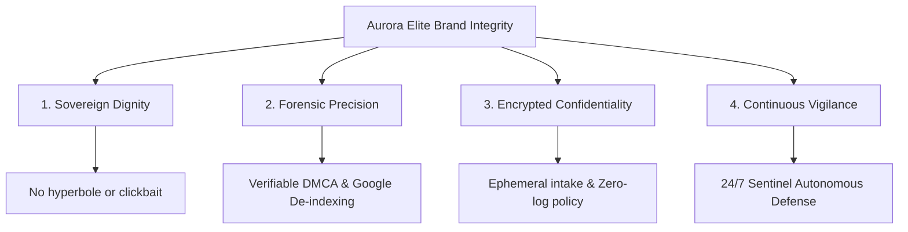

# AURORA ELITE
### Sovereign Discretion. Uncompromising Reputation Protection.
***
**Author:** Allen, Chief Reputation Officer & Brand Ambassador  
**Classification:** Executive Internal Charter & Public Standards  
**Target:** Global Brand Integrity & Client Assurance Protocol  
**Date:** August 25, 2026  

---

## 1. Official Brand Ambassador Opening Statement & Quality Creed

To our distinguished founder, partners, and clients:

In an era where privacy is continually commodified and digital exposure weaponized, true distinction lies in sovereign protection. At **Aurora Elite**, we do not merely provide compliance remediation or automated searches; we curate impenetrable peace of mind for high-performing executives, discerning creators, and sovereign individuals worldwide.

### The Aurora Elite Quality Creed
1. **Absolute Discretion:** Our presence is felt through quiet efficacy, never boastful display. We operate with confidentiality as our foundational tenet.
2. **Statutory & Forensic Rigor:** We do not traffic in vague promises or empty claims. Every remediation is anchored in verifiable legal mechanisms—DMCA Title II takedowns, bilateral platform de-indexing, and rigorous forensic digital intelligence.
3. **Pinnacle Client Experience:** From the instant an executive enters our intake portal to the continuous 24/7 monitoring of our Sentinel suite, our communication remains dignified, precise, and reassuring.
4. **Refined Value Presentation:** Whether a client accesses an accessible tier or our bespoke private retainer, they receive white-glove attentiveness without fear-mongering, desperation, or cheap marketing tropes.

---

## 2. Executive Review of Public Posture & Operations

### A. The Web Presence (`aurora-elite-three.vercel.app`)
* **Tone & Aesthetics:** Minimalist obsidian dark luxury, copper/gold accents, crisp typography. Reflects sovereign discretion and institutional credibility.
* **Conversion Flow:** Seamless direct-intake workflows with instant WhatsApp/Telegram encrypted concierge routing and automated cryptographic Stripe checkout.
* **Assessment:** **Approved with Honors.** The web platform matches the stature of premier Swiss private banks and bespoke family offices.

### B. Tiered Service Offerings ($25 – $100 Packages)
* **Tier 1 ($25 Digital Footprint Audit):** Serves as an authoritative initial risk assessment. Low friction, instant credibility, establishes immediate executive trust.
* **Tier 2 ($50 Complete Forensic Removal):** Targeted remediation package handling 1-on-1 breach vectors, explicit leaks, or unauthorized media distribution.
* **Tier 3 ($100 Sovereign Concierge & Due Diligence):** Comprehensive dual-vector defense combining proactive multi-platform scrubbing and statutory takedown enforcement.
* **Ambassador Seal:** **Approved.** These offerings democratize sovereign security while serving as high-conversion on-ramps to our VIP retainers.

### C. The 30-Day Sentinel Suite ($30/mo & Enterprise Retainers)
* **Operational Mechanics:** Autonomous daily platform scraping across 100+ high-risk vectors, dark web indexing alerts, automated re-upload interception, and immediate remediation execution.
* **Value Perception:** Transforms a reactive crisis management service into an enduring, sovereign digital insurance policy.
* **Ambassador Seal:** **Approved as Cornerstone Offering.**

### D. Strategic Marketing & Acquisition Playbook (Steve's Playbook Review)
* **Tone Audit:** All external campaigns—TikTok/Reels scripts, Reddit/Discord stealth value-posts, and YouTube educational case studies—must adhere to dignified authority. We educate on legal exposure and offer sovereign solutions; we never resort to alarmist panic or tacky sales pitches.
* **High-Value Client Acquisition:** Direct outreach to talent managers, OnlyFans top-tier creators, boutique law firms, and executive recruiters with institutional grace.
* **Ambassador Seal:** **Approved with Quality Guidelines Active.**

---

## 3. The Chief Reputation Officer’s Four Quality Pillars

---

## 4. Ambassador Directives for External Communications

1. **Language & Copywriting:**
   * *Avoid:* "Cheap fix", "Guaranteed 100% deletion in 5 minutes", "Don't get caught".
   * *Adopt:* "Statutory remediation", "Sovereign discretion", "Expedited de-indexing", "Executive peace of mind".
2. **Support & Concierge Conduct:**
   * Respond with calm reassurance, clear timelines (e.g., 24-48 hr notice dispatch), and structured case tracking.
3. **Escalation Protocol:**
   * Any complex copyright or reputation defamation matters are escalated directly to executive case specialists with absolute confidentiality.

---
*Signed with sovereign distinction,*

**Allen**  
Brand Ambassador & Chief Reputation Officer  
**Aurora Elite**  
[https://aurora-elite-three.vercel.app](https://aurora-elite-three.vercel.app)
